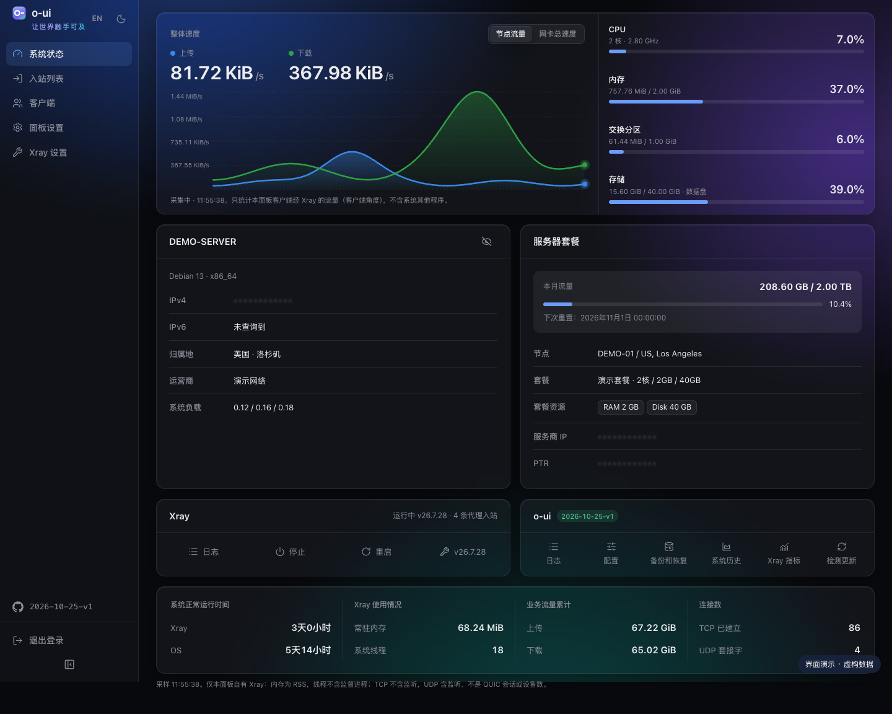
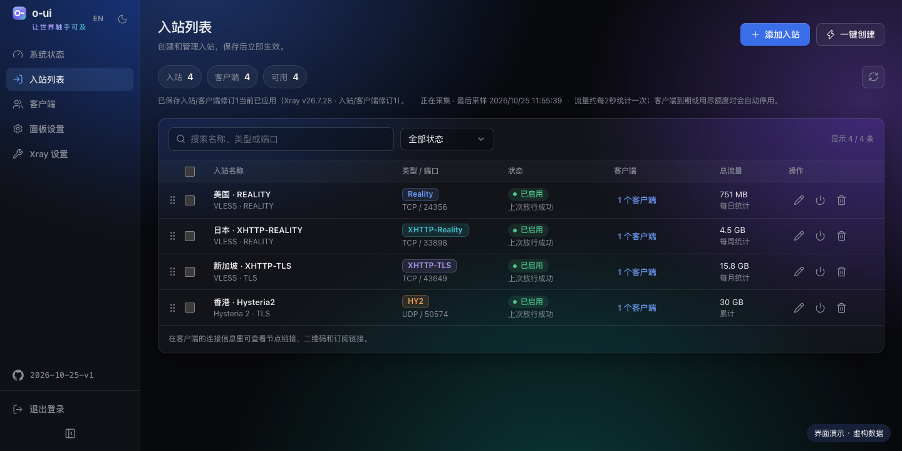
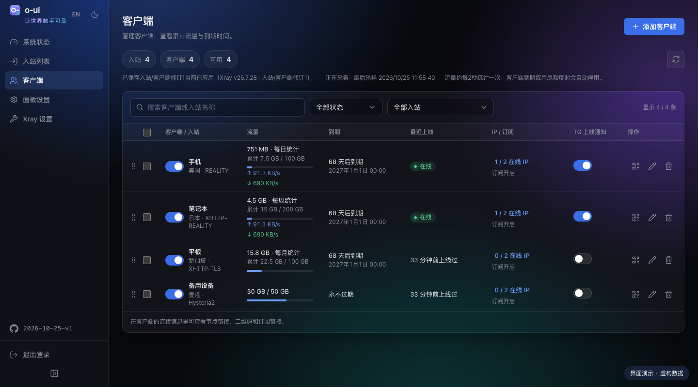
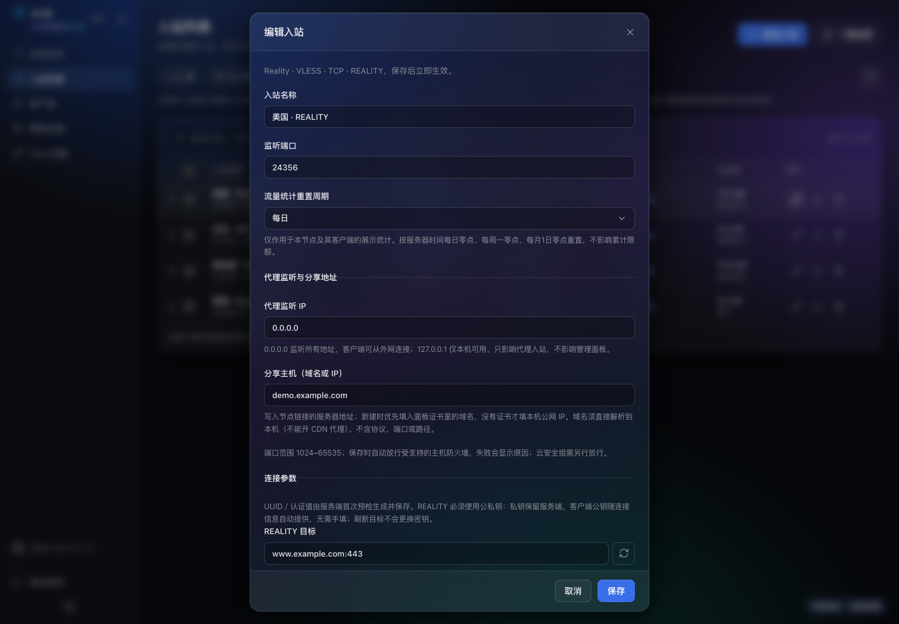
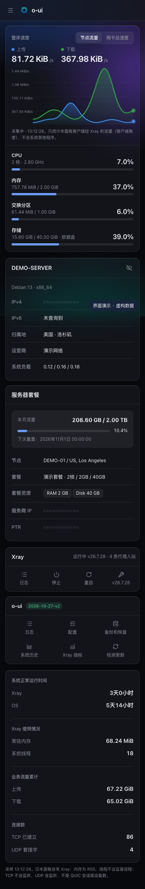
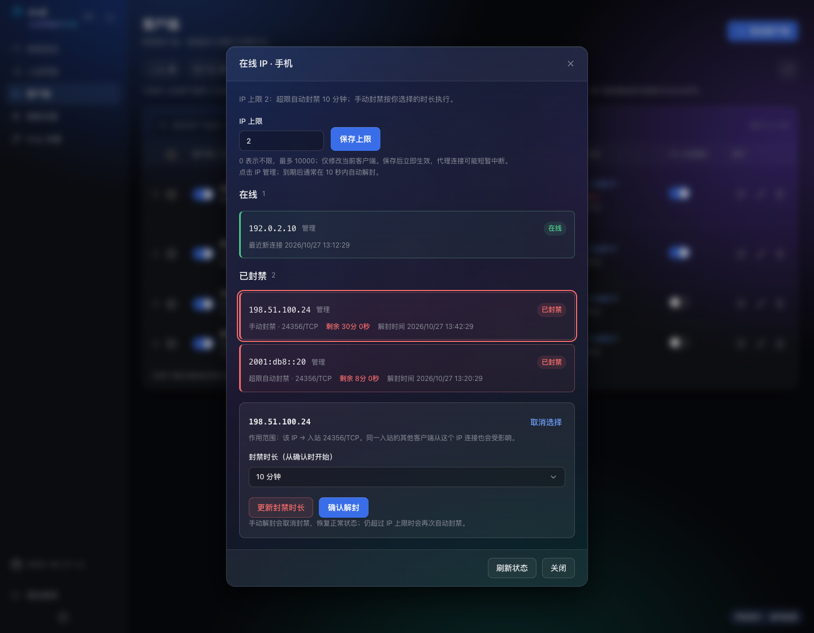

<p align="center">
  
</p>

<h1 align="center">o-ui</h1>
<p align="center"><strong>让世界触手可及</strong></p>
<p align="center">面向独立 VPS 的 Xray 管理面板，一键创建节点，集中管理客户端、在线 IP、流量和服务器维护。</p>

<p align="center">
  <a href="https://github.com/tpxcer/o-ui/releases/latest"></a>
  <a href="LICENSE"></a>
  
  
  <a href="https://t.me/tpxcer"></a>
</p>

<p align="center">
  <a href="#界面预览">界面预览</a> · <a href="#项目特点">项目特点</a> · <a href="#快速安装">快速安装</a> · <a href="docs/guide.md">使用指南</a> · <a href="https://github.com/tpxcer/o-ui/releases">版本记录</a> · <a href="https://t.me/tpxcer">讨论群</a>
</p>

## 界面预览

以下截图展示当前界面，使用本机隔离演示数据拍摄；服务器、设备及流量均为虚构，不包含生产信息或节点凭据。首页预览随 GitHub 的深浅色偏好切换。

<picture>
  <source media="(prefers-color-scheme: light)" srcset="docs/images/dashboard-light.png">
  
</picture>

<table>
  <tr>
    <th>入站列表</th>
    <th>客户端管理</th>
  </tr>
  <tr>
    <td></td>
    <td></td>
  </tr>
</table>

<details>
  <summary>查看每节点统计周期设置与手机界面</summary>
  <p>在节点内部选择不重置、每日、每周或每月；界面同时适配手机。</p>
  
  
</details>

## 项目特点

### 创建节点，保存即应用

- 一键创建 **VLESS + TCP + REALITY、VLESS + XHTTP + REALITY、VLESS + XHTTP + TLS、Hysteria2** 四种入站。
- 保存时先由官方 Xray 核心预检，再应用配置；预检或新核心启动失败时保留或恢复原运行配置，并显示原因。
- 自动处理受支持的主机防火墙端口规则，显示放行结果，失败时可单独重试。支持 UFW、firewalld，以及指定布局的原生 nftables；未知拦截规则会明确报告。云安全组需另行配置。
- TLS 入站可直接复用已生效的面板 HTTPS 证书；REALITY 支持 Vision 开关及可选的 Mihomo 兼容设置。

### 每个节点独立统计

- 节点编辑窗口内单独选择**不重置、每日、每周、每月**，客户端继承所属节点的统计周期。
- 按服务器时间每日零点、每周一零点、每月 1 日零点切换周期；**只重置展示统计，累计流量限额用量保持不变**。
- 实时速度上传蓝色、下载绿色；在线显示心跳动效，不在线只显示最近上线时间，并隐藏速度。
- 支持客户端流量上限、到期时间和同时在线 IP 上限；入站与客户端记录均可拖动排序。

### 在线 IP 与封禁管理

- 点击客户端的“在线 IP / 上限”，在同一个弹窗内查看 IP、直接设置当前客户端的 **IP 上限**；**0 表示不限**。
- 同时在线 IP 超限时，保留先连上的 IP，对后来的 IP 自动封禁 10 分钟；绿色显示在线、红色显示封禁、黄色显示到期等待解封。
- 点击具体 IP 可选择 **10 分钟、30 分钟、1 小时、24 小时、7 天或永久**封禁，显示来源、倒计时和完整到期时间；没有设置上限也能手动封禁。
- **手动解封直接取消封禁、恢复正常状态**；仍然超限时会按上限规则再次判定。
- 封禁按“源 IP + 入站端口 / 协议”生效，同一入站的其他客户端从该 IP 连接也会受影响，操作前会明确提示范围。



### 管理与维护集中完成

| 能力 | 提供什么 |
| --- | --- |
| 访问保护 | 独立管理员登录、双重验证、自定义访问路径、HTTPS 访问与敏感信息显隐 |
| 服务器监控 | 网速曲线、CPU、内存、交换空间、磁盘及负载；切换节点流量与网卡总速度，查看自有 Xray 的资源占用 |
| HTTPS 与续签 | ACME 域名或 IP 证书、HTTP-01 / Cloudflare DNS 验证、自动续期、强制重新申请；签发成功自动部署并配置面板 HTTPS，同端口 HTTP 自动跳转 HTTPS |
| 官方核心管理 | 下载与校验官方 Xray、选择已安装版本、切回上一版本；面板与核心独立管理 |
| 路由与 DNS | 可视化路由、出站、负载均衡和 DNS；高级 JSON 编辑，另支持 VLESS 反向代理与 WARP 出站配置 |
| 分享与订阅 | 节点链接、二维码，单客户端 Base64 / Clash-Mihomo / Xray JSON 订阅；支持重置和撤销订阅地址，客户端列表同时显示全局停用状态 |
| Telegram | 登录、客户端上线与离线、资源与 IP 超限通知；服务器名称与公网 IP 标识，日 / 周 / 月报告和备份 |
| 备份与迁移 | 可选密码加密的业务备份，恢复前预览与回退副本；支持导入 OUI / 3x-ui 数据库中的兼容入站及客户端 |
| 安装与升级 | Linux 一键安装、编号管理菜单、可选 UFW / BBR、网页与命令行更新、升级失败回退 |
| 界面体验 | 青绿蓝圆环图标、极光磨砂界面、深浅色主题、手机适配、统一弹窗、IP 显隐、简体中文与英文 |

删除客户端时，若所属入站已经没有其他客户端，会同步删除该入站；共享入站仍有客户端时保留，确认框会列明删除范围。

后端使用 **Go + SQLite**，前端使用 **TypeScript + Vite**。服务器运行发布包无需安装 Node.js，也不依赖旧 x-ui 服务。

## 支持的入站

| 类型 | 协议与传输 | 说明 |
| --- | --- | --- |
| REALITY | VLESS / TCP / REALITY | 可选择是否使用 XTLS Vision 流控 |
| XHTTP-REALITY | VLESS / XHTTP / REALITY | 支持 XHTTP 路径与模式配置 |
| XHTTP-TLS | VLESS / XHTTP / TLS | 支持复用面板证书 |
| HY2 | Hysteria2 / UDP / TLS | 支持复用面板证书及可选端口跳跃 |

出站另提供 VLESS、VMess、Trojan、Shadowsocks、Hysteria2、SOCKS、HTTP、直连、阻断及 WARP 等配置；出站支持范围与入站预设不同。

## 快速安装

适用于使用 **systemd** 的 Linux，发布架构为 **amd64（x86_64）** 与 **arm64（aarch64）**。以 root 运行：

```bash
bash <(curl -fsSL https://raw.githubusercontent.com/tpxcer/o-ui/main/install.sh)
```

也可从 [Releases](https://github.com/tpxcer/o-ui/releases/latest) 下载 `install.sh` 与 `SHA256SUMS`，核对后执行：

```bash
curl -fLO https://github.com/tpxcer/o-ui/releases/latest/download/install.sh
curl -fLO https://github.com/tpxcer/o-ui/releases/latest/download/SHA256SUMS
sha256sum -c --ignore-missing SHA256SUMS && sudo bash install.sh
```

安装器依次询问语言、端口、访问路径、管理员、HTTPS 证书，以及可选的 BBR 与防火墙；首次安装可确认安装整套 UFW，先放行当前 SSH、面板及证书验证所需端口，再启用入站策略。已有防火墙规则时保留现状，不覆盖接管。

安装后显示 HTTPS 访问地址与登录信息，登录后首页地址以 `/panel/` 结尾；有自定义访问路径时保留在其前面。运行 `o-ui` 可进入管理菜单。

```bash
o-ui                       # 打开管理菜单
o-ui status                # 查看服务状态
o-ui update                # 更新面板，保留数据
o-ui cert                  # 配置证书与自动续期
o-ui cert renew --force    # 手动强制续期
o-ui log                   # 查看日志
```

安装脚本会尝试安装官方 Xray 最新正式版，已有核心选择保持不变。不同核心版本与客户端的兼容性可能不同，可在面板内选择其他版本。

完整问答、HTTP-01 临停网站的确认与恢复机制、离线安装、目录与权限、备份恢复和管理命令见 **[安装与使用指南](docs/guide.md)**。

## 从 OUI / 3x-ui 迁移

在“**备份和恢复**”中选择原面板导出的 `x-ui.db`，填写分享主机，核对预览后确认导入。支持范围内保留原有端口、客户端身份、REALITY 参数、启停与限额及累计用量，便于继续使用已有节点链接。

不支持的入站会列明跳过原因；原面板管理员、Telegram 和路由设置不导入。原证书位于 `/root` 等受限目录时，可在入站编辑里改为复用面板证书。迁移前应备份并协调旧核心监听端口，详细范围见[迁移说明](docs/guide.md#业务备份和恢复)。

## 使用说明

- 每个订阅地址对应**一个客户端的一个节点**，用于让客户端拉取连接配置；不是多个 VPS 的节点聚合。使用前需在“面板设置 → 订阅”开启全局订阅服务，同时开启该客户端的订阅选项。订阅地址应作为凭据保管。
- 多台 VPS 可共用 Telegram 机器人发送带服务器标识的通知；目前同一机器人不支持多台面板同时长轮询管理指令。
- IP 上限依赖防火墙助手，在线 IP 数不等于设备数；流量统计按采样累计，不作为精确计费依据。
- HTTP-01 需要公网可达的 80/TCP；DNS 验证无需占用该端口。临停网站仅在用户确认具体目标后执行，续期部署可能造成面板及代理短暂重连。

## 本地开发

需要 Node.js 22.18+ 与 Go 1.26.9+，在项目目录运行：

```bash
npm ci
npm run dev:core
```

另开终端运行 `npm run dev`，浏览器打开 `http://127.0.0.1:5178/`；首次自行设置管理员。

```bash
npm test
npm run build
go test ./...
go test -race ./...
go vet ./...
```

## 交流与反馈

使用问题、建议和功能讨论欢迎加入 [Telegram 讨论群](https://t.me/tpxcer)；可复现的缺陷请在 [GitHub Issues](https://github.com/tpxcer/o-ui/issues) 提交。请勿在群里或 Issue 中贴出节点链接、订阅地址、面板访问路径等凭据。

## 许可与来源

本项目源码采用 **[GNU GPL-3.0](LICENSE)**。Xray 核心与 Geo 数据按各自许可从官方来源下载，前端与 Go 依赖的许可随发布包提供。

[来源与依赖](SOURCES.md) · [安全边界](安全边界.md) · [安装与使用指南](docs/guide.md) · [问题反馈](https://github.com/tpxcer/o-ui/issues)
